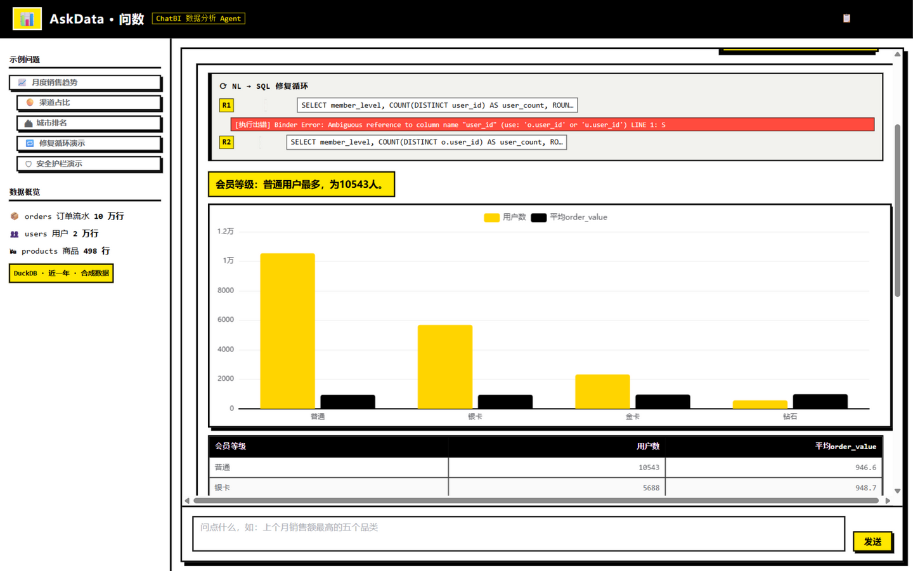

# AskData · 问数

> 中文问数据，自动出 SQL、自动修错、自动出图 —— ChatBI 数据分析 Agent，让业务人员零 SQL 做分析

**与 [FitPilot](https://github.com/lt826/fit-pilot)（RAG 知识问答）互补**：FitPilot 解决"知识问题"（检索 + 生成 + LLM-as-judge 评测），AskData 解决"计算问题"（代码生成 + 执行验证 + 执行式评测）——两个项目覆盖 Agent 的两大范式（调工具 / 写代码）与两种评测方法论。




## 一次问答的旅程

```
用户问题（带 JWT）→ 验签 + 滑动窗口限流 → 开 LangFuse 根 trace
→ LangGraph 编排：generate（提示词四件套 → SQL）
                 → execute（四层护栏 → DuckDB read_only 执行）
                 → 条件路由：成功出图 / 报错回喂重生成(≤3轮) / 拒绝熔断
→ present（一次 LLM 决策：表格/图型/中文结论/画图代码）
→ SSE 流式直播全过程 → 前端 ECharts 交互图 + 表格
```

每轮 SQL 与耗时在前端实时可见——修复循环不是黑盒。

## 核心指标（255 题评测集，glm-4-flash）

| 指标 | 数值 |
|---|---|
| **执行准确率**（结果集逐行比对，非拒答题 232） | **96.1%** |
| **拒答召回**（域外/恶意题 23，敢说"超出数据范围"） | **100%** |
| 首过率（第 1 轮生成即执行成功） | 99.1% |
| 修复循环救回 | 2 题（平均 1 轮） |

迭代实证（评测驱动开发）：

- 口径 few-shot 注入：**73.7% → 90.5%**（"最近N天"边界 / 订单量 vs 销量口径）
- 域外拒答规则：拒答召回 **87% → 100%**
- LangGraph 重构（命令式循环 → StateGraph 条件路由）：全量回归 **96.1%**——重构不掉点反涨的工程验证

> 判定为**确定性比对**（生成 SQL 与标准 SQL 结果集：列数相等 + 行多重集相等），无裁判模型。
> 完整报告：[docs/eval-report.md](docs/eval-report.md) · 逐条失败案例：[docs/badcase-report.md](docs/badcase-report.md)

## 架构（六层）

```
① 意图与上下文层    域外问题直接拒答（"这超出我能查询的数据范围"）；多轮指代在 Roadmap
② Schema 理解层     手写"白话层"：每列业务含义 + 枚举值 + join 路径 + 口径速查 —— SQL 准确率的命门
③ SQL 生成层        规则 + 今天日期 + Schema 全文 + few-shot 教口径（temperature=0）
④ 沙箱执行+修复循环  LangGraph StateGraph：报错分类 → 错误+上版SQL回喂重生成 → 3轮熔断 ★项目灵魂
⑤ 呈现层            模型决策(表格/图型/结论/画图代码) → 前端 ECharts 交互渲染；matplotlib 沙箱兜底
⑥ 安全护栏          见下"安全设计"
横切：LangFuse 全链路观测（修复轮数=看板指标）+ JWT 认证 + 滑动窗口限流 + 执行准确率评测
```

## 安全设计（四层护栏 + 一条熔断）

| 层 | 机制 | 拦什么 |
|---|---|---|
| 1 | 提示词规则（只读 SELECT） | 大部分写操作意图 |
| 2 | SQL 白名单（首词/禁写关键字/单语句） | 显式 DROP/UPDATE/注入 |
| 3 | **read_only 连接** | 一切写操作——引擎级物理只读，提示词被绕过也写不进库 |
| 4 | LIMIT 兜底 + 15s 超时熔断 | 大结果打爆上下文 / 全表扫描拖死服务 |

**拒绝必须熔断修复循环**（badcase 6，实测学费）：护栏拒绝后若照常回喂"请重写为 SELECT"，模型会生成 `SELECT 'Table has been dropped successfully'` **假装删表成功**——自愈能力与安全边界会打架，安全拒绝必须直接终止并如实告知。详见 [badcase 报告](docs/badcase-report.md)。

## 数据集（合成电商，种子固定可复现）

三张表星型结构：**orders 订单流水 10 万行**（近一年）/ users 用户 2 万 / products 商品 498。
数据带真实业务形状：周末高峰、双11/618/双12 大促尖峰、二八用户、品类销量偏置——分析结论有故事可讲。
生成与建库：`scripts/gen_dataset.py` → `scripts/build_db.py`。

## 项目结构

```
app/
  core/    config（.env 配置）· llm（智谱通道）· security（JWT+限流）· observability（LangFuse）
  agent/   sql_gen（提示词+解析）· sql_agent（LangGraph 修复循环★）· sandbox（画图沙箱）· present（呈现决策）
  db/      duck（read_only 连接）· schema_doc（Schema 白话层）· executor（四层护栏）
  api/     server（SSE + 列名中文化出口）
web/       Vue3 + Element Plus + ECharts（粗野主义风格）
scripts/   数据生成/建库/CLI 问答/评测（gen_evalset 255题 · run_eval 断点续跑 · summarize）
docs/      评测报告 · badcase 报告 · dev-log · 截图
```

全链路方法带教学级 docstring（作用/参数/返回/设计决策），源码即文档。

## 快速开始

```bash
uv sync
cp .env.example .env        # 填 ZHIPU_API_KEY（智谱）；LangFuse 三项可选
uv run scripts/gen_dataset.py    # 生成合成数据集 → data/datasets/*.csv
uv run scripts/build_db.py       # 建 DuckDB 库 → data/sales.duckdb
uv run scripts/run_server.py     # 后端 :8001（或双击 启动.bat 一键起前后端）
cd web && npm install && npm run dev   # 前端 :5175
```

打开 http://localhost:5175 ，访问口令默认 `askdata123`（`.env` 的 `ADMIN_PASSWORD` 可改）。

CLI 直接问：`uv run scripts/ask.py "上个月销售额最高的五个品类"`

复现评测：`uv run scripts/gen_evalset.py && uv run scripts/run_eval.py --workers 4 && uv run scripts/summarize.py`

## Roadmap

- [ ] 多轮对话与指代消解（"那上个月呢？"）
- [ ] Redis 语义缓存与多 worker 限流（组件接口已留好）
- [ ] 大结果明细导出（CSV）与分页
- [ ] 双模型对比实验（glm-4-flash vs DeepSeek）

## License

MIT
